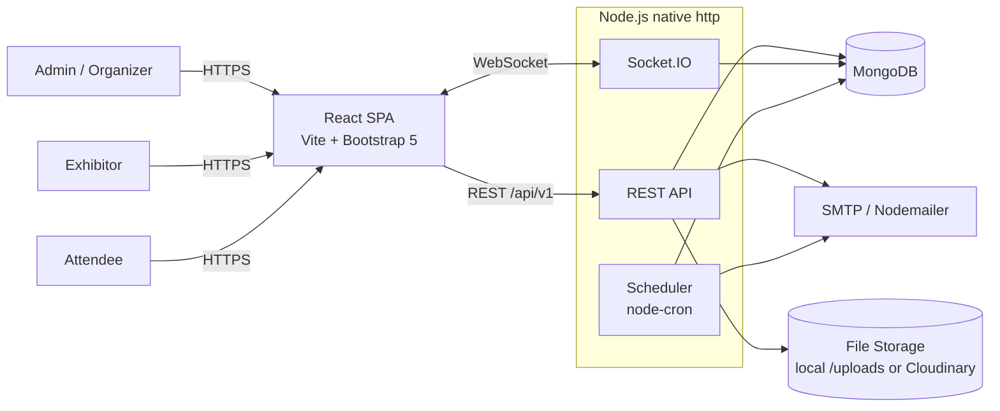
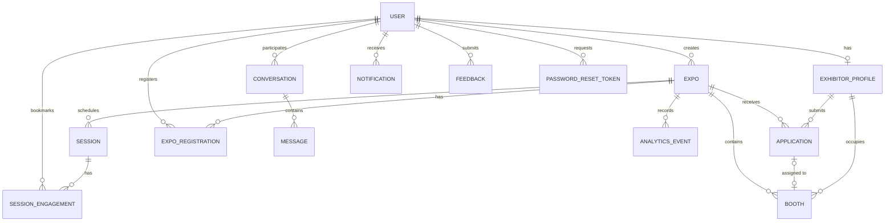
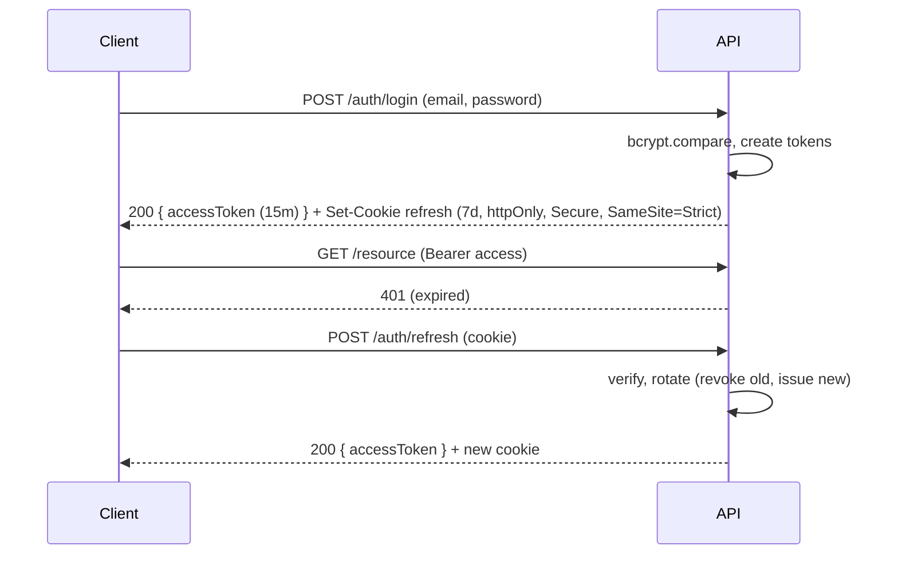

# EventSphere Management — Architecture

> **Project:** EventSphere Management (Aptech eProject) — React + Bootstrap, plain Node.js (no Express), MongoDB
> **Document status:** v1.1 — stack revised: Bootstrap for UI, native Node.js `http` (no Express)
> **Related docs:** [prd.md](./prd.md) · [design.md](./design.md) · [rules.md](./rules.md) · [tasks.md](./tasks.md) · [memory.md](./memory.md)

---

## 1. Purpose & Scope

This document describes **how** EventSphere is built: the system structure, technology choices, data model, API surface, real-time design, security model, and deployment approach. Product behaviour ("what") lives in `prd.md`; UI/UX lives in `design.md`.

The system digitises expo and trade-show management for three roles:

| Role | Slug | Primary purpose |
|------|------|-----------------|
| Admin / Organizer | `admin` | Create expos, manage floor plans, approve exhibitors, run schedules, view analytics |
| Exhibitor | `exhibitor` | Apply to expos, reserve booths, manage profile, communicate |
| Attendee | `attendee` | Browse expos, register for sessions, search exhibitors, bookmark |

---

## 2. Architectural Drivers

Derived from the non-functional requirements in the brief:

| Driver | Target | Architectural response |
|--------|--------|------------------------|
| Response time | 1–2 s for most operations | Indexed Mongo queries, pagination, lean reads, React Query caching, gzip |
| Concurrency | Hundreds of concurrent users | Stateless API, Socket.IO with Redis adapter option, connection pooling |
| Scalability | Horizontal scaling | Stateless Node processes behind a load balancer; no in-memory session state |
| Security | Encrypted data, secure auth, RBAC | bcrypt, JWT + httpOnly refresh cookie, TLS, secure-headers middleware, rate limiting, RBAC middleware |
| Privacy | GDPR-style consent & control | Consent capture, data export/delete endpoints, minimal PII, audit of consent |
| Reliability | ≥ 99% uptime, backups | Health checks, process manager, automated Mongo backups |
| Usability / A11y | Responsive, WCAG | Mobile-first React, semantic HTML, ARIA, keyboard support |
| Observability | Logging + monitoring | Structured logs (pino), request IDs, `/health` and `/metrics` endpoints |
| Testability | Unit + integration + E2E | Layered architecture with dependency-injectable services |

---

## 3. System Context



---

## 4. Technology Stack

### 4.1 Frontend (`/client`)

| Concern | Choice | Notes |
|---------|--------|-------|
| Framework | **React 18** + **Vite** | Fast dev server, simple build |
| Language | JavaScript (ES2022) with JSDoc; TypeScript optional | Keep within eProject skill scope |
| Routing | React Router v6 | Role-guarded routes |
| Server state | TanStack Query v5 | Caching, retries, invalidation on socket events |
| Client state | React Context (auth, theme, socket) | Avoid heavy global stores |
| Forms | React Hook Form + Zod resolver | Shared validation vocabulary with server |
| UI framework | **Bootstrap 5.3** + **React-Bootstrap** | Grid, utilities, components; JS behaviours via React-Bootstrap (not Bootstrap's own JS bundle) |
| Theming | Sass variable overrides + CSS custom properties | Tokens from `design.md`; dark mode via `data-bs-theme` |
| Icons | Bootstrap Icons | SVG sprite / per-icon imports |
| Charts | Recharts | Analytics dashboard |
| Floor plan | Custom **SVG** component | Interactive, zoomable, accessible |
| Real-time | `socket.io-client` | Single shared connection |
| HTTP | Axios | Interceptors for token refresh |
| Dates | date-fns | Timezone-safe formatting |
| Testing | Vitest + React Testing Library; Playwright (E2E) | |

### 4.2 Backend (`/server`)

| Concern | Choice | Notes |
|---------|--------|-------|
| Runtime | **Node.js 20 LTS** | |
| HTTP server | **Node.js native `http` module** + small in-house core (router, middleware pipeline) | **No Express** (or Koa/Fastify/Hapi). See §5.3 and ADR-09 |
| Database | **MongoDB 6+** via **Mongoose 8** | Atlas or local |
| Auth | JWT (access) + rotating refresh token in httpOnly cookie | |
| Password hashing | `bcryptjs` / `bcrypt` (cost ≥ 12) | |
| Validation | **Zod** | Schemas per route |
| Real-time | **Socket.IO 4** | Rooms per expo/user/conversation |
| Email | Nodemailer | Password reset, reminders, approvals |
| Scheduling | node-cron | Session reminders, token cleanup |
| Uploads | `busboy` multipart parser (+ Cloudinary adapter) | Logos, documents, banners |
| Security | In-house middleware: secure headers, CORS, rate limiter, NoSQL-key sanitiser, query normaliser | Built in `core/` (see §5.3, §11) |
| Logging | pino + pino-http | JSON logs with request ID |
| Testing | Jest + Supertest (works directly with `http.Server`) + mongodb-memory-server | Core modules unit-tested |
| API docs | OpenAPI 3 JSON served by a tiny route + Swagger UI static assets | `/api/docs` in non-prod |

### 4.3 Tooling

ESLint + Prettier, Husky + lint-staged, Conventional Commits, dotenv, GitHub Actions CI (lint → test → build).

---

## 5. High-Level Structure

### 5.1 Repository layout (monorepo, npm workspaces)

```
eventsphere/
├── client/
│   ├── public/
│   └── src/
│       ├── app/                 # providers, router, query client
│       ├── components/          # shared UI (Button, Modal, DataTable, Toast…)
│       ├── features/
│       │   ├── auth/
│       │   ├── expos/
│       │   ├── floorplan/
│       │   ├── exhibitors/
│       │   ├── schedule/
│       │   ├── messaging/
│       │   ├── analytics/
│       │   ├── notifications/
│       │   └── feedback/
│       ├── hooks/
│       ├── lib/                 # axios instance, socket client, utils
│       ├── pages/               # route-level components per role
│       ├── styles/              # custom.scss: Bootstrap variable overrides + import
│       └── main.jsx
├── server/
│   ├── src/
│   │   ├── core/                # router, pipeline, ctx, body, cookies, static, compress, security, rate-limit
│   │   ├── config/              # env, db, logger, mailer, cloudinary
│   │   ├── models/              # Mongoose schemas
│   │   ├── modules/
│   │   │   └── <feature>/
│   │   │       ├── <feature>.routes.js
│   │   │       ├── <feature>.controller.js
│   │   │       ├── <feature>.service.js
│   │   │       └── <feature>.schema.js   # Zod
│   │   ├── middleware/          # route-level: auth, rbac, validate, upload
│   │   ├── sockets/             # io setup, handlers, rooms
│   │   ├── jobs/                # cron jobs
│   │   ├── utils/               # tokens, pagination, helpers
│   │   ├── app.js               # builds the request handler (no listen)
│   │   └── server.js            # http + socket bootstrap
│   ├── tests/
│   └── seed/
├── docs/                        # user guide, developer guide, API export
├── .github/workflows/
├── architecture.md · design.md · memory.md · prd.md · rules.md · tasks.md
└── package.json
```

### 5.2 Backend layering

```
Route  →  Middleware (auth, rbac, validate)  →  Controller  →  Service  →  Model (Mongoose)
```

| Layer | Responsibility | Must NOT |
|-------|---------------|----------|
| Routes | Wire path, middleware, controller | Contain logic |
| Controller | Parse request, call service, shape response | Touch models directly |
| Service | Business rules, transactions, emit events | Know about `req`/`res` |
| Model | Schema, indexes, hooks, virtuals | Contain business workflows |

Controllers are thin; services are unit-testable without HTTP.

### 5.3 HTTP core (plain Node.js — no Express)

The API is served by `node:http`. A small in-house core in `server/src/core/` (~300–400 lines, fully unit-tested) replaces what a framework would provide. Socket.IO attaches to the same `http.Server`.

| Module | Responsibility |
|--------|----------------|
| `router.js` | `get/post/put/patch/delete(path, ...handlers)`. Paths such as `/expos/:id/booths` are compiled to RegExp once at boot; returns handlers + `params`. Unknown path → `404`; known path, wrong method → `405` with `Allow` header |
| `pipeline.js` | `compose(middlewares)` — Koa-style onion `async (ctx, next)`; one `try/catch` boundary that hands errors to the central error handler (so async errors can never go unhandled) |
| `context.js` | Builds `ctx = { req, res, method, path, query, params, body, files, cookies, user, requestId, log }` and helpers: `ctx.json(status, data, meta)`, `ctx.noContent()`, `ctx.setCookie()`, `ctx.clearCookie()` |
| `body.js` | JSON body parser (1 MB limit, content-type check → `415`); multipart via **busboy** with file-size/count limits |
| `cookies.js` | Parse `Cookie`; serialise `Set-Cookie` (`HttpOnly`, `Secure`, `SameSite`, `Path`, `Max-Age`) |
| `security.js` | Secure headers (CSP, `nosniff`, HSTS, `frame-ancestors`, `Referrer-Policy`), strict CORS incl. preflight `OPTIONS`, NoSQL-key sanitiser (reject keys starting with `$` or containing `.`), query normaliser (no unexpected arrays — replaces `hpp`) |
| `rate-limit.js` | Sliding-window limiter keyed by IP (+ email for auth); in-memory store with a pluggable interface (Mongo TTL collection or Redis for multi-instance) |
| `static.js` | Serves `/uploads` safely: resolved-path prefix check (no traversal), `nosniff`, `Content-Disposition` for documents, cache headers |
| `compress.js` | gzip/brotli via `node:zlib` for JSON > 1 KB when `Accept-Encoding` allows |
| `errors.js` | `ApiError` family + `errorHandler` → standard envelope |

**Request flow**

```
http.createServer
  → requestId → logger → secureHeaders → cors → rateLimit(global) → cookies → body → sanitise
  → router.match
  → [route middleware: requireAuth → requireRole → validate(zod)]
  → controller(ctx) → service → model
  → ctx.json → compress → res.end
```

**Handler & route style**

```js
// booth.routes.js
router.post('/booths/:id/reserve',
  requireAuth, requireRole(ROLES.EXHIBITOR), validate(reserveSchema), boothController.reserve);

// booth.controller.js
export async function reserve(ctx) {
  const booth = await boothService.reserve(ctx.user, ctx.params.id);
  ctx.json(200, booth);
}
```

Controllers receive `ctx` only; services never see `ctx`, `req` or `res`. `/socket.io/*` requests are handled by Socket.IO before the router.

---

## 6. Data Architecture

### 6.1 Entity-relationship overview



### 6.2 Collections

All collections include `createdAt` / `updatedAt` (Mongoose `timestamps: true`). IDs are `ObjectId`.

#### `users`
| Field | Type | Notes |
|-------|------|-------|
| name | String | required, 2–80 |
| email | String | required, unique, lowercase, indexed |
| passwordHash | String | `select: false` |
| role | Enum | `admin` \| `exhibitor` \| `attendee`; **admin cannot be self-registered** |
| phone, avatarUrl | String | optional |
| isActive | Boolean | default `true` |
| consent | Object | `{ privacyAccepted: Boolean, acceptedAt: Date, marketing: Boolean }` |
| refreshTokens | [Object] | `{ tokenHash, expiresAt, userAgent, ip }` — rotated on use |
| lastLoginAt | Date | |

#### `exhibitorprofiles`
| Field | Type | Notes |
|-------|------|-------|
| user | ObjectId → users | unique |
| companyName | String | required |
| logoUrl, website | String | |
| description | String | ≤ 2000 |
| category | String | indexed (for filters) |
| tags / productsServices | [String] | text-indexed |
| contact | `{ email, phone, address }` | |
| staff | [`{ name, role, email }`] | |
| documents | [`{ name, url, mimeType, size }`] | |

#### `expos`
| Field | Type | Notes |
|-------|------|-------|
| title, slug | String | slug unique |
| description, theme | String | |
| startDate, endDate | Date | `endDate ≥ startDate` |
| venue | `{ name, address, city, country }` | |
| bannerUrl | String | |
| status | Enum | `draft` → `published` → `ongoing` → `completed` \| `cancelled` |
| floorPlan | `{ width, height, gridSize, backgroundUrl? }` | canvas units |
| createdBy | ObjectId → users | |

Indexes: `{ status: 1, startDate: 1 }`, text index on `title, description, theme`.

#### `booths`
| Field | Type | Notes |
|-------|------|-------|
| expo | ObjectId → expos | |
| code | String | e.g. `A-01`; unique per expo |
| x, y, w, h | Number | position/size on floor plan |
| size | Enum | `small` \| `medium` \| `large` |
| price | Number | optional |
| status | Enum | `available` \| `reserved` \| `allocated` \| `blocked` |
| exhibitor | ObjectId → exhibitorprofiles | nullable |
| details | `{ showcase: String, products: [String], staff: [..] }` | exhibitor-editable |

Indexes: `{ expo: 1, code: 1 }` unique, `{ expo: 1, status: 1 }`.

#### `applications`
| Field | Type | Notes |
|-------|------|-------|
| expo, exhibitor | ObjectId | unique pair `{expo, exhibitor}` |
| status | Enum | `pending` \| `approved` \| `rejected` \| `withdrawn` |
| companySnapshot | Object | frozen copy at submission |
| productsServices | [String] | |
| documents | [Object] | |
| preferredBooths | [ObjectId → booths] | ordered preference |
| assignedBooth | ObjectId → booths | set on approval |
| reviewNote, reviewedBy, reviewedAt | | |

#### `sessions`
| Field | Type | Notes |
|-------|------|-------|
| expo | ObjectId | indexed |
| title, description, topic/track | String | |
| type | Enum | `keynote` \| `session` \| `workshop` |
| startTime, endTime | Date | validate no room overlap |
| location | String | room/hall name |
| speakers | [`{ name, org, bio, photoUrl }`] | |
| capacity | Number | optional |
| status | Enum | `scheduled` \| `updated` \| `cancelled` |

Index: `{ expo: 1, startTime: 1 }`, `{ expo: 1, location: 1, startTime: 1 }`.

#### `expo_registrations`
`{ user, expo, ticketCode (unique), checkedInAt? }` — unique `{user, expo}`.

#### `session_engagements`
`{ user, session, expo, kind: 'bookmark'|'registered', reminderSentAt? }` — unique `{user, session, kind}`.

#### `conversations` / `messages`
- **conversation:** `{ participants: [ObjectId] (2), expo?, type: 'support'|'exhibitor-attendee'|'exhibitor-exhibitor', lastMessage, lastMessageAt }` — index on `participants`.
- **message:** `{ conversation, sender, body (≤ 2000), readBy: [ObjectId] }` — index `{ conversation: 1, createdAt: -1 }`.

#### `notifications`
`{ user, type, title, body, link, readAt? }` — index `{ user: 1, readAt: 1, createdAt: -1 }`.

#### `feedback`
`{ user, expo?, category: 'suggestion'|'issue'|'support', message, rating?, status: 'open'|'in_review'|'resolved' }`.

#### `analytics_events`
`{ expo, type: 'booth_view'|'profile_view'|'session_view'|'session_checkin'|'search', user?, refId?, meta? }` — index `{ expo: 1, type: 1, createdAt: -1 }`; optional TTL for retention.

#### `password_reset_tokens`
`{ user, tokenHash, expiresAt (TTL index), usedAt? }` — raw token only ever sent by email.

### 6.3 Data integrity rules
- Booth reservation is **atomic**: `findOneAndUpdate({_id, status:'available'}, {$set:{status:'reserved', exhibitor}})` — returns null if someone else won the race → `409 Conflict`.
- Schedule overlap check on `(expo, location, time range)` inside the service before write.
- Approving an application sets booth `allocated` and application `approved` in a **Mongo transaction** (replica set required; Atlas provides it).
- Soft delete is not used for expos; deleting an expo requires `draft`/`cancelled` status or cascades via a service method with confirmation.

---

## 7. API Design

**Base URL:** `/api/v1` · **Format:** JSON · **Auth:** `Authorization: Bearer <accessToken>`

### 7.1 Response envelope

```jsonc
// success
{ "success": true, "data": { ... }, "meta": { "page": 1, "limit": 20, "total": 134 } }

// error
{ "success": false, "error": { "code": "VALIDATION_ERROR", "message": "…", "details": [ { "path": "email", "message": "Invalid email" } ] } }
```

Standard codes: `VALIDATION_ERROR` 400 · `UNAUTHENTICATED` 401 · `FORBIDDEN` 403 · `NOT_FOUND` 404 · `CONFLICT` 409 · `RATE_LIMITED` 429 · `INTERNAL_ERROR` 500.

### 7.2 Endpoint catalogue

Legend — **Auth:** 🌐 public · 🔑 any logged-in · 🅰 admin · 🅴 exhibitor · 🅣 attendee

| Module | Method & Path | Auth | Description |
|--------|---------------|------|-------------|
| **Auth** | `POST /auth/register` | 🌐 | Register as exhibitor or attendee |
| | `POST /auth/login` | 🌐 | Returns access token + sets refresh cookie |
| | `POST /auth/refresh` | 🌐 (cookie) | Rotate refresh, issue access |
| | `POST /auth/logout` | 🔑 | Revoke refresh token |
| | `POST /auth/forgot-password` | 🌐 | Email reset link (always 200) |
| | `POST /auth/reset-password` | 🌐 | Consume token, set new password |
| | `GET /auth/me` | 🔑 | Current user |
| **Users** | `PATCH /users/me` | 🔑 | Update profile |
| | `PATCH /users/me/password` | 🔑 | Change password |
| | `GET /users/me/export` | 🔑 | GDPR data export |
| | `DELETE /users/me` | 🔑 | Delete/anonymise account |
| | `GET /users` · `PATCH /users/:id` | 🅰 | Manage users / deactivate |
| **Expos** | `GET /expos` | 🌐 | List published (filters, search, paginate) |
| | `GET /expos/:id` | 🌐 | Detail |
| | `POST /expos` | 🅰 | Create |
| | `PATCH /expos/:id` | 🅰 | Update |
| | `DELETE /expos/:id` | 🅰 | Delete |
| | `POST /expos/:id/register` | 🅣 | Register for expo (returns ticket) |
| | `GET /expos/me/registrations` | 🅣 | My registrations |
| **Booths / Floor plan** | `GET /expos/:id/booths` | 🌐 | Floor plan + status |
| | `PUT /expos/:id/booths` | 🅰 | Bulk save floor plan layout |
| | `POST /expos/:id/booths` · `PATCH /booths/:id` · `DELETE /booths/:id` | 🅰 | CRUD booth |
| | `POST /booths/:id/reserve` | 🅴 | Atomic reserve (approved applicants only) |
| | `PATCH /booths/:id/details` | 🅴 | Edit own booth showcase/staff |
| | `POST /booths/:id/assign` | 🅰 | Assign/unassign exhibitor |
| **Applications** | `POST /expos/:id/applications` | 🅴 | Submit application |
| | `GET /applications/me` | 🅴 | My applications |
| | `PATCH /applications/:id/withdraw` | 🅴 | Withdraw |
| | `GET /expos/:id/applications` | 🅰 | List/filter by status |
| | `PATCH /applications/:id/review` | 🅰 | Approve/reject (+ booth) |
| **Exhibitors** | `GET /exhibitors` | 🌐 | Search/filter (`q`, `category`, `expo`) |
| | `GET /exhibitors/:id` | 🌐 | Public profile + booth location |
| | `GET/PUT /exhibitors/me` | 🅴 | Own profile |
| | `POST /exhibitors/me/documents` | 🅴 | Upload (multipart) |
| **Sessions** | `GET /expos/:id/sessions` | 🌐 | Schedule (filter by day, track, type) |
| | `POST /expos/:id/sessions` | 🅰 | Create |
| | `PATCH /sessions/:id` · `DELETE /sessions/:id` | 🅰 | Update / cancel |
| | `POST /sessions/:id/register` · `DELETE …/register` | 🅣 | Register / unregister |
| | `POST /sessions/:id/bookmark` · `DELETE …/bookmark` | 🔑 | Bookmark |
| | `GET /sessions/me` | 🔑 | My agenda |
| **Messaging** | `GET /conversations` | 🔑 | List mine |
| | `POST /conversations` | 🔑 | Start (role rules enforced) |
| | `GET /conversations/:id/messages` | 🔑 | Paginated history |
| | `POST /conversations/:id/messages` | 🔑 | Send (also via socket) |
| | `PATCH /conversations/:id/read` | 🔑 | Mark read |
| **Notifications** | `GET /notifications` · `PATCH /notifications/:id/read` · `PATCH /notifications/read-all` | 🔑 | |
| **Feedback** | `POST /feedback` | 🔑 | Submit |
| | `GET /feedback` · `PATCH /feedback/:id` | 🅰 | Triage |
| **Analytics** | `POST /analytics/events` | 🔑 | Record view/checkin |
| | `GET /expos/:id/analytics/summary` | 🅰 | KPIs |
| | `GET /expos/:id/analytics/{engagement,booths,sessions}` | 🅰 | Time series & rankings |
| | `GET /expos/:id/reports/export?type=csv` | 🅰 | CSV export |
| **System** | `GET /health` · `GET /metrics` | 🌐/internal | Liveness + metrics |

### 7.3 Cross-cutting API rules
- **Pagination:** `?page=1&limit=20` (max 100) → `meta`.
- **Filtering/sorting:** `?sort=-startDate&status=published&q=keyword`.
- **Idempotency:** `register`/`bookmark` endpoints are idempotent (unique indexes + upsert).
- **Versioning:** URL prefix; breaking changes → `/v2`.

---

## 8. Authentication & Authorization

### 8.1 Token strategy



- Access token held **in memory** only (never localStorage). Refresh token is an httpOnly cookie.
- Refresh-token **reuse detection**: if a revoked token is replayed, revoke the whole token family.
- JWT payload: `{ sub, role, iat, exp }` — nothing else.

### 8.2 Password reset
1. `forgot-password` → generate 32-byte random token, store **SHA-256 hash** + 30-min expiry, email link `/reset-password?token=…`.
2. Response is always `200` (no account enumeration).
3. `reset-password` → verify hash, set new password, mark token used, revoke all refresh tokens.

### 8.3 RBAC & ownership
- `requireAuth` → `requireRole('admin')` middleware chain.
- **Ownership checks live in services** (e.g., exhibitor can only edit booths where `booth.exhibitor === myProfile._id`).
- Attendees can read public data and their own registrations/bookmarks/messages only.
- Only an **approved** application permits booth reservation for that expo.

---

## 9. Real-Time Architecture

Socket.IO attached to the same HTTP server. Handshake authenticates with the access token (`auth: { token }`).

| Room | Joined by | Purpose |
|------|-----------|---------|
| `user:{userId}` | the user on connect | Personal notifications, direct messages |
| `expo:{expoId}` | clients viewing an expo | Schedule/booth/expo changes |
| `conversation:{id}` | participants | Typing, new messages |
| `admin:{expoId}` | admins | Live analytics ticks, new applications |

| Event (server → client) | Payload | Trigger |
|-------------------------|---------|---------|
| `expo:updated` | `{ expoId, changes }` | Expo edit |
| `booth:updated` | `{ boothId, status, exhibitor? }` | Reserve/assign/release |
| `schedule:updated` | `{ sessionId, action: 'created'|'updated'|'cancelled' }` | Session CRUD |
| `notification:new` | notification doc | Any notification |
| `message:new` | message doc | Chat |
| `application:new` / `application:reviewed` | summary | Application lifecycle |
| `analytics:tick` | KPI delta | Throttled (≤ 1/5 s) |

**Client rule:** socket events *invalidate TanStack Query keys*; they do not mutate cache by hand (single source of truth = server).

**Scaling:** for >1 Node instance enable `@socket.io/redis-adapter` and sticky sessions at the load balancer.

---

## 10. Background Jobs

| Job | Schedule | Action |
|-----|----------|--------|
| `sessionReminders` | every minute | Find bookmarked/registered sessions starting in ~15 min with no `reminderSentAt` → in-app notification + email, set `reminderSentAt` |
| `expoStatusTransition` | hourly | `published → ongoing → completed` based on dates |
| `tokenCleanup` | daily | Purge expired refresh/reset tokens |
| `analyticsRollup` (optional) | hourly | Pre-aggregate counts for heavy dashboards |

Jobs are idempotent and safe to run on multiple instances using a Mongo-based lock (or run on a single worker).

---

## 11. Security Architecture

| Threat | Control |
|--------|---------|
| Credential stuffing / brute force | Rate limit `/auth/*` (e.g., 10/15 min/IP+email), generic error messages, optional lockout |
| XSS | React escaping, no `dangerouslySetInnerHTML`, CSP via `security.js`, sanitize rich text |
| CSRF | Access token via header; refresh cookie `SameSite=Strict` + `POST` only + origin check |
| NoSQL injection | `core/security.js` key sanitiser, Zod validation, never pass raw `ctx.body` to queries |
| Parameter pollution | Query normaliser in `core/security.js`; Zod rejects arrays unless declared |
| Sensitive data exposure | TLS everywhere, `passwordHash` `select:false`, redact logs (`authorization`, `cookie`, `password`) |
| File upload abuse | MIME + magic-byte check, busboy size/count limits (5 MB images / 10 MB docs), random filenames, no execution path, `nosniff` on served files |
| Broken access control | Central RBAC + service-level ownership checks + tests per role |
| Dependency risk | `npm audit` in CI, Dependabot |
| Secrets | `.env` only, never committed; `.env.example` maintained |

**Privacy (GDPR-aligned):** explicit consent checkbox at registration (stored with timestamp), privacy policy page, data export (`GET /users/me/export`), erasure (`DELETE /users/me` anonymises PII, keeps aggregate analytics), data minimisation, retention TTL on analytics/logs.

---

## 12. Frontend Architecture

- **Route guards:** `<ProtectedRoute roles={['admin']}>` wraps role areas: `/admin/*`, `/exhibitor/*`, `/attendee/*`; public routes: `/`, `/expos`, `/expos/:id`, `/login`, `/register`, `/forgot-password`, `/reset-password`.
- **Data fetching:** feature-level hooks (`useExpos`, `useBooths(expoId)`) wrap TanStack Query; components never call Axios directly.
- **Auth bootstrap:** on load call `/auth/refresh` → `/auth/me`; show splash until resolved.
- **Axios interceptor:** on 401 → single-flight refresh → retry once → else logout.
- **Code splitting:** `React.lazy` per role area; analytics/charts lazy-loaded.
- **Styling:** `styles/custom.scss` overrides Bootstrap Sass variables (colours, radius, container widths) *before* importing Bootstrap, so only tokens from `design.md` are used. Use React-Bootstrap components (`Modal`, `Offcanvas`, `Dropdown`, `Toast`, `Tabs`) — never Bootstrap's own JS bundle or `data-bs-*` imperative behaviour. Dark mode via `data-bs-theme` on `<html>`. Import only the Bootstrap Sass partials needed to keep CSS small.
- **Error boundaries** at app and route level; toast for recoverable errors.
- **Floor-plan component:** SVG viewBox from `expo.floorPlan`; `<Booth>` rects keyed by id; pan/zoom via pointer events; colour by status; keyboard focusable with `aria-label="Booth A-01, available"`; admin mode adds drag/resize with grid snapping.

---

## 13. Quality Attributes — Implementation Notes

| Attribute | Practice |
|-----------|----------|
| Performance | `.lean()` reads, projections, compound indexes, pagination, `compression`, image resizing, React Query `staleTime` |
| Reliability | Graceful shutdown (close server → close Mongo), `/health` checks DB, process manager (PM2/Docker restart policy) |
| Backups | `mongodump` nightly (or Atlas continuous backup), 7-day + 4-week retention, quarterly restore drill |
| Logging | pino JSON, `x-request-id` correlation, levels via env; errors never leak stack to clients in prod |
| Monitoring | `/metrics` (prom-client) — request latency, error rate, active sockets; uptime pinger against `/health` |
| Testing | Unit (services/utilities) · Integration (Supertest + in-memory Mongo) · E2E (Playwright: auth, apply→approve→reserve, session register) · Security (OWASP ZAP baseline, `npm audit`) |
| Accessibility | eslint-plugin-jsx-a11y, axe checks in CI, manual keyboard pass |

---

## 14. Environments & Deployment

| Env | Purpose | Notes |
|-----|---------|-------|
| `local` | Development | Mongo via Docker or Atlas free tier; MailHog/Ethereal for email |
| `staging` | Demo / QA | Mirrors prod config, seeded data |
| `production` | Live | HTTPS, managed Mongo, backups on |

**Deployment topology (simple):**
`Client static build (Netlify/Vercel/Nginx)` + `API (Render/Railway/Docker on VPS)` + `MongoDB Atlas` + `SMTP provider` + `Cloudinary`.

**Docker (optional):** `docker-compose.yml` with `client`, `server`, `mongo`, `mailhog`.

**CI/CD (GitHub Actions):** `lint → test (server+client) → build → deploy (main only)`.

### 14.1 Environment variables (`server/.env.example`)

```
NODE_ENV=development
PORT=5000
CLIENT_URL=http://localhost:5173
MONGO_URI=mongodb://localhost:27017/eventsphere
JWT_ACCESS_SECRET=change-me
JWT_REFRESH_SECRET=change-me-too
ACCESS_TOKEN_TTL=15m
REFRESH_TOKEN_TTL=7d
BCRYPT_ROUNDS=12
SMTP_HOST= SMTP_PORT= SMTP_USER= SMTP_PASS= MAIL_FROM=
CLOUDINARY_URL=
UPLOAD_DIR=./uploads
LOG_LEVEL=info
```
`client/.env`: `VITE_API_URL`, `VITE_SOCKET_URL`.

---

## 15. Architecture Decision Records (summary)

| # | Decision | Rationale | Trade-off |
|---|----------|-----------|-----------|
| ADR-01 | Modular monolith (not microservices) | Right size for the project & team; simpler ops | Must keep module boundaries disciplined |
| ADR-02 | MongoDB + Mongoose | Required by the brief; flexible docs for profiles/floor plans | No cross-collection joins; transactions need replica set |
| ADR-03 | JWT access (memory) + refresh (httpOnly cookie) | Mitigates XSS token theft; supports rotation | Slightly more complex than single token |
| ADR-04 | Socket.IO for real-time | Fallbacks, rooms, ack support, easy scaling | Extra server surface; needs sticky sessions at scale |
| ADR-05 | Custom SVG floor plan | Full control, accessible, no heavy library | More build effort than an image map |
| ADR-06 | Zod for validation on both sides | One schema vocabulary; great errors | Schemas duplicated unless shared package is added |
| ADR-07 | TanStack Query for server state | Caching + invalidation pairs well with socket events | Learning curve |
| ADR-08 | Atomic Mongo ops for booth reservation | Prevents double-booking under concurrency | Requires careful query design |
| ADR-09 | **Plain Node.js `http` core, no Express** (owner decision D-013) | Project-owner requirement; fewer dependencies; full control and learning value | We own routing/body/CORS/security code → must be small, tested, and security-reviewed |
| ADR-10 | **Bootstrap 5.3 + React-Bootstrap** (owner decision D-014) | Familiar, fast to build responsive UI, built-in a11y patterns | Generic look unless Sass tokens are customised; keep Bootstrap JS out of React |

---

## 16. Risks & Open Technical Questions

| Risk | Mitigation |
|------|-----------|
| Booth double-booking under load | Atomic conditional updates + 409 handling + test with parallel requests |
| Floor-plan editor complexity | Ship grid-snap rectangles first; defer polygons/rotation |
| Email deliverability | Use provider with SPF/DKIM; fall back to in-app notifications |
| Socket scaling beyond one node | Redis adapter documented; not required for MVP demo |
| Hand-rolled HTTP core has bugs/security gaps | Keep `core/` minimal; unit tests per module; fuzz body/path inputs; security review in T-9.3; don't re-implement framework features that aren't needed |
| GDPR scope creep | Implement consent, export, delete; document the rest in privacy policy |

**Open questions** are tracked in `memory.md` § Open Questions.
