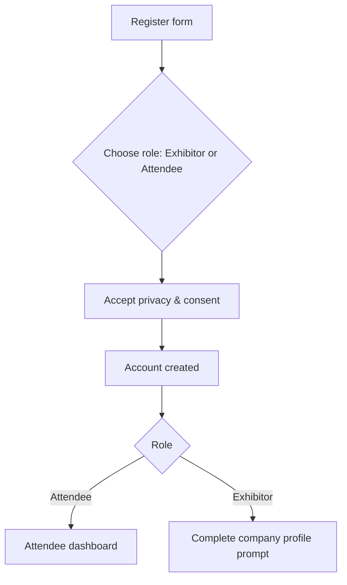
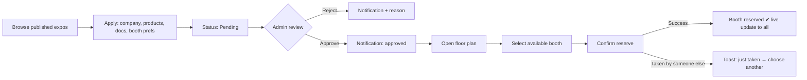
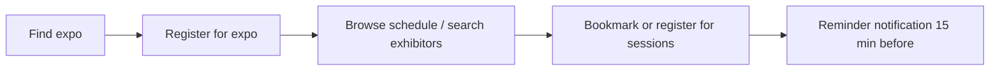
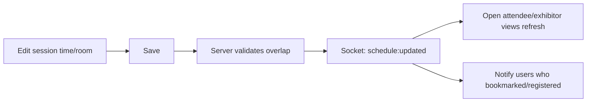

# EventSphere Management — UI/UX Design

> **Document status:** v1.1 — UI built with React + Bootstrap 5.3
> **Related docs:** [prd.md](./prd.md) · [architecture.md](./architecture.md) · [rules.md](./rules.md) · [tasks.md](./tasks.md) · [memory.md](./memory.md)

---

## 1. Design Goals

| Goal | What it means in practice |
|------|---------------------------|
| **Clarity** | Each screen has one primary action. Status is always visible (booth state, application state, session state). |
| **Role-fit** | Admin, Exhibitor, Attendee each get a tailored navigation and dashboard — never a one-size-fits-all menu. |
| **Live feel** | Changes made by others (booth taken, session moved) appear without refresh, with a subtle, non-jarring indication. |
| **Responsive** | Mobile-first. Attendees are most likely on phones at the venue; admins mostly on desktop. |
| **Accessible** | WCAG 2.1 AA: contrast, keyboard, screen-reader labels, reduced motion. |
| **Trustworthy** | Clean, professional, data-forward. Consistent patterns reduce errors on high-stakes actions (approve, delete, reserve). |

---

## 2. Personas

| Persona | Role | Goals | Pain points today | Primary device |
|---------|------|-------|-------------------|----------------|
| **Olivia Reed** — Expo Organizer | admin | Run a smooth expo, fill booths, keep schedule accurate, see performance | Spreadsheets, email chains, last-minute changes | Desktop |
| **Marcus Chen** — Marketing Manager at a startup | exhibitor | Get a good booth, showcase products, meet leads, talk to organizers | Unclear booth availability, slow approvals | Laptop + phone |
| **Priya Nair** — Visitor / industry professional | attendee | Find relevant exhibitors, plan her day, get reminders | Printed schedules, no way to pre-plan | Phone |

---

## 3. Information Architecture

### 3.1 Sitemap

```
Public
├── Home (/)
├── Expos list (/expos)
│   └── Expo detail (/expos/:id)  → Overview · Schedule · Exhibitors · Floor plan
├── Login (/login)
├── Register (/register)
├── Forgot password (/forgot-password)
├── Reset password (/reset-password)
├── Privacy policy (/privacy)
└── Help / FAQ (/help)

Attendee (/attendee)
├── Dashboard
├── My agenda (bookmarks + registered sessions)
├── My registrations (expo tickets)
├── Exhibitor directory
├── Messages
├── Notifications
├── Feedback
└── Profile & privacy

Exhibitor (/exhibitor)
├── Dashboard
├── Company profile
├── Expos & applications
│   └── Apply / track status
├── Booth management
│   └── Floor-plan picker · Booth details · Staff
├── Messages (organizers, neighbours)
├── Notifications
├── Feedback / support
└── Account

Admin (/admin)
├── Dashboard (live KPIs)
├── Expos
│   └── Create / edit · Floor plan editor · Booths
├── Exhibitor applications
├── Schedule manager
├── Analytics & reports
├── Users
├── Messages (support inbox)
├── Feedback inbox
└── Settings
```

### 3.2 Navigation patterns

| Breakpoint | Pattern |
|------------|---------|
| ≥ 992 px (`lg`) | Persistent **left sidebar** (role-specific) + top bar (search, notifications bell, avatar menu) |
| 768–991 px (`md`) | Collapsible sidebar (hamburger → Offcanvas) |
| < 768 px | **Bottom tab bar** (4–5 key items) for attendees; hamburger drawer for admin/exhibitor |

---

## 4. Key User Flows

### 4.1 Registration → role-based landing

> Admin accounts are created by seed script / an existing admin — never via public form.

### 4.2 Exhibitor: apply → approved → reserve booth


### 4.3 Attendee: discover → plan → remind


### 4.4 Admin: schedule change propagates live


---

## 5. Visual Design System

### 5.1 Brand feel
Modern, confident, event-industry energy: deep indigo for trust, vivid accents for status. Plenty of white space; cards over dense tables where possible on mobile.

### 5.2 Colour tokens

Implemented as **Bootstrap Sass variable overrides** (`$primary`, `$success`, `$warning`, `$danger`, `$info`, body/bg colours) in `styles/custom.scss`, exposed at runtime as Bootstrap CSS variables (`--bs-primary`, etc.). Dark values are applied under `[data-bs-theme="dark"]`.

| Token | Light | Dark | Use |
|-------|-------|------|-----|
| `--color-primary-600` | `#4F46E5` | `#818CF8` | Primary buttons, links, active nav |
| `--color-primary-700` | `#4338CA` | `#6366F1` | Hover/pressed |
| `--color-primary-50` | `#EEF2FF` | `#1E1B4B` | Subtle backgrounds |
| `--color-accent-500` | `#F59E0B` | `#FBBF24` | Highlights, badges, featured |
| `--color-success-600` | `#16A34A` | `#4ADE80` | Approved, available |
| `--color-warning-600` | `#D97706` | `#FBBF24` | Pending, reserved |
| `--color-danger-600` | `#DC2626` | `#F87171` | Rejected, delete, errors |
| `--color-info-600` | `#0284C7` | `#38BDF8` | Info banners |
| `--color-neutral-900` | `#0F172A` | `#F8FAFC` | Primary text |
| `--color-neutral-600` | `#475569` | `#CBD5E1` | Secondary text |
| `--color-neutral-200` | `#E2E8F0` | `#334155` | Borders |
| `--color-surface` | `#FFFFFF` | `#0B1220` | Cards |
| `--color-bg` | `#F8FAFC` | `#020617` | Page background |

All text/background pairs meet **≥ 4.5:1** (normal) / **3:1** (large + UI components). Status is **never colour-only** — always paired with an icon or label.

### 5.3 Booth status colours (floor plan)

| Status | Fill | Stroke | Icon/Pattern | Interactivity |
|--------|------|--------|--------------|---------------|
| Available | `#DCFCE7` | `#16A34A` | ✓ | Selectable (approved exhibitors) |
| Reserved | `#FEF3C7` | `#D97706` | ⏳ | Not selectable |
| Allocated | `#E0E7FF` | `#4F46E5` | ● (shows company initials/logo) | Click → exhibitor profile |
| Blocked | `#E2E8F0` | `#64748B` | ✕ diagonal hatch | Not selectable |
| Selected (current user) | `#4F46E5` fill, white text | `#312E81` | thick outline | — |

### 5.4 Typography

| Role | Font | Weight | Size / line-height |
|------|------|--------|--------------------|
| Display (H1) | Inter / system-ui | 700 | 36 / 44 (desktop), 28 / 36 (mobile) |
| H2 | Inter | 600 | 28 / 36 |
| H3 | Inter | 600 | 20 / 28 |
| Body | Inter | 400 | 16 / 24 |
| Small / caption | Inter | 400 | 14 / 20 |
| Mono (codes, ticket IDs) | JetBrains Mono | 500 | 14 / 20 |

### 5.5 Spacing, radius, elevation

- **Spacing:** Bootstrap spacers — `1=4px, 2=8px, 3=16px, 4=24px, 5=48px` (utilities `m-*`, `p-*`, `gap-*`).
- **Radius:** `$border-radius-sm: 6px` (inputs, chips) · `$border-radius: 10px` (cards, buttons) · `$border-radius-lg: 16px` (modals) · `rounded-pill` / `rounded-circle` (badges, avatars).
- **Elevation:** `shadow-sm` (cards) · `shadow` (dropdowns) · `shadow-lg` (modals).
- **Grid:** Bootstrap 12-col grid; `container` with `xl` max-width set to 1200 px (public pages), `container-fluid` with sidebar (dashboards). Breakpoints: `sm 576 · md 768 · lg 992 · xl 1200 · xxl 1400`.

### 5.6 Iconography
**Bootstrap Icons**, 20 px default (`1.25rem`). Always with `aria-hidden` when decorative or an accessible label when standalone.

### 5.7 Motion
150–200 ms ease-out for hover/press; 250 ms for modals/drawers. Respect `prefers-reduced-motion` (disable transforms, keep opacity fades). Live-update highlight: 1.2 s background flash (`primary-50`) on changed row/booth.

---

## 6. Component Library

| Component | Variants / states | Notes |
|-----------|-------------------|-------|
| **Button** | primary, secondary, ghost, danger; sm/md/lg; loading, disabled | Loading shows spinner + keeps width |
| **Input / Textarea / Select** | default, focus, error, disabled | Label above, helper + error text below, `aria-describedby` |
| **PasswordInput** | show/hide toggle, strength meter | Strength meter on register/reset only |
| **Badge / StatusPill** | success, warning, danger, info, neutral | Icon + text |
| **Card** | default, interactive (hover lift), selected | Expo card, exhibitor card, session card |
| **DataTable** | sortable, filterable, paginated, row actions, empty state | Collapses to stacked cards < 768 px |
| **Modal / ConfirmDialog** | sm/md/lg | Focus trap, `Esc` closes, destructive confirm requires typed name for expo delete |
| **Drawer** | right-side details | Applications review, booth details |
| **Tabs** | underline | Expo detail: Overview / Schedule / Exhibitors / Floor plan |
| **Toast** | success, error, info | Top-right (desktop), bottom (mobile); `role="status"` / `alert` |
| **Skeleton** | text, card, table row | Used instead of spinners for page loads |
| **EmptyState** | icon + message + CTA | Every list has one |
| **Avatar / CompanyLogo** | image + initials fallback | |
| **SearchBar** | debounced (300 ms), clear button, suggestions | |
| **FilterChips** | multi-select categories | |
| **DateTimePicker** | range, timezone label | |
| **Stepper** | numbered, linear | Exhibitor application wizard |
| **FloorPlan (SVG)** | view / select / edit modes; zoom, pan, legend | See §8 |
| **ScheduleTimeline** | day tabs, room columns (desktop), agenda list (mobile) | |
| **ChatPanel** | conversation list + thread, typing indicator, unread badge | |
| **NotificationBell** | popover list, unread count | |
| **StatCard / Chart** | KPI number + delta; line, bar, donut | Recharts, accessible data-table alternative |

### 6.1 Bootstrap Implementation Map

| Design component | Implement with |
|------------------|----------------|
| Button | React-Bootstrap `Button` (`variant="primary"`, `"secondary"`, `"outline-*"`, `"danger"`, `size`, `disabled`); loading = inline `Spinner` |
| Input / Textarea / Select | `Form.Control`, `Form.Select`, `Form.Label`, `Form.Text`, `Form.Control.Feedback` (`isInvalid`) |
| PasswordInput | `InputGroup` + toggle button; strength meter = `ProgressBar` |
| Badge / StatusPill | `Badge` with `bg="success"`, `"warning"`, `"danger"`, `"info"`, `"secondary"` + Bootstrap Icon |
| Card | `Card` (`Card.Body`, `Card.Img`); interactive = `.card-hover` custom class + `stretched-link` |
| DataTable | `Table` (`responsive`, `hover`) + `Pagination`; stacked cards under `md` via `d-md-none` / `d-none d-md-block` |
| Modal / ConfirmDialog | `Modal` (focus trap built-in); typed-title confirm via `Form.Control` |
| Drawer | `Offcanvas` (`placement="end"`) |
| Tabs | `Tabs` / `Nav variant="tabs"` |
| Toast | `ToastContainer` + `Toast` (`role="status"` / `alert`) |
| Skeleton | `Placeholder` (`animation="glow"`) |
| EmptyState | Custom component using `text-center`, icon, `Button` |
| Avatar / CompanyLogo | `` + initials fallback |
| SearchBar | `InputGroup` + debounced `Form.Control` |
| FilterChips | `Badge` / `Button size="sm" variant="outline-primary"` toggles |
| Stepper | `Nav` pills / `ProgressBar` + step content |
| Layout & nav | `Navbar`, `Nav`, `Offcanvas` sidebar, `Container`/`Row`/`Col` |
| Dropdowns / menus | `Dropdown` |
| NotificationBell | `Dropdown` with `Badge` (unread count) |
| Alerts / banners | `Alert` (e.g. "Reconnecting…") |
| FloorPlan, ScheduleTimeline, ChatPanel, Charts | Custom components (SVG / CSS grid / Recharts) styled with Bootstrap utilities and CSS variables |

**Rules:** use React-Bootstrap components, never Bootstrap's JS bundle; customise through Sass variables first, utility classes second, small custom classes last (no inline styles except SVG geometry).

---

## 7. Page Designs (Wireframes)

> Low-fidelity ASCII wireframes. Final visual polish follows the tokens above.

### 7.1 Public home (`/`)
```
┌────────────────────────────────────────────────────────────┐
│ ◈ EventSphere     Expos   Help            [Login][Sign up] │
├────────────────────────────────────────────────────────────┤
│   Discover, exhibit, and experience expos — live.           │
│   [ Browse expos ]   [ Become an exhibitor ]                │
│   ┌────────┐ ┌────────┐ ┌────────┐   Featured expos         │
│   │ banner │ │ banner │ │ banner │                          │
│   │ title  │ │ title  │ │ title  │                          │
│   │ date·📍│ │ date·📍│ │ date·📍│                          │
│   └────────┘ └────────┘ └────────┘                          │
│   How it works:  ① Register  ② Plan/Book  ③ Attend          │
└────────────────────────────────────────────────────────────┘
```

### 7.2 Login / Register
```
┌──────────────── Sign in ────────────────┐
│ Email      [__________________]         │
│ Password   [__________________] 👁      │
│ [ Sign in ]        Forgot password?     │
│ ─────────── or ───────────              │
│ New here? Create an account             │
└─────────────────────────────────────────┘

Register:  Name · Email · Password (+strength) · Confirm
           Role  (◉ Attendee  ○ Exhibitor)
           ☐ I accept the Privacy Policy (required)
           ☐ Send me event updates (optional)
```
Error handling: inline field errors + a summary at top on submit; generic "Invalid email or password" on login failure.

### 7.3 Admin dashboard (`/admin`)
```
┌ Sidebar ┐ ┌──────────────────────────────────────────────────┐
│ Dashboard│ │ Expo: [ TechExpo 2026 ▾ ]            🔔  (OR)   │
│ Expos    │ │ ┌────────┐┌────────┐┌────────┐┌────────┐         │
│ Apps (7) │ │ │Attend. ││Exhib.  ││Booths  ││Sessions│  StatCards│
│ Schedule │ │ │ 1,284  ││  86    ││ 74/90  ││  42    │         │
│ Analytics│ │ └────────┘└────────┘└────────┘└────────┘         │
│ Users    │ │ ┌── Registrations over time ──┐ ┌─ Booth status ─┐│
│ Messages │ │ │ line chart                  │ │ donut          ││
│ Feedback │ │ └─────────────────────────────┘ └────────────────┘│
│ Settings │ │ Pending applications        Top sessions         │
│          │ │ ▸ Acme Co.  [Review]        1. Keynote — 420     │
└──────────┘ └──────────────────────────────────────────────────┘
```

### 7.4 Expo form (admin create/edit)
Two-column on desktop: **Details** (title, theme, description, dates, venue, banner upload, status) · **Floor plan setup** (canvas size, grid size) → "Save & open floor-plan editor". Autosave draft indicator; validation inline.

### 7.5 Floor-plan editor (admin) — see §8
```
┌ Toolbar: [Select][Add booth][Delete] Grid: 20 ☑snap  Zoom −/+ ┐
│ ┌──────────────────────────────────────────────┐ ┌─ Booth ─┐│
│ │  ┌──┐ ┌──┐ ┌──┐        ┌────┐                │ │ Code A-03││
│ │  │A1│ │A2│ │A3│        │ B1 │                │ │ Size  M  ││
│ │  └──┘ └──┘ └──┘        └────┘                │ │ Price    ││
│ │          (drag / resize with snap)            │ │ Status   ││
│ └──────────────────────────────────────────────┘ │ Assign ▾ ││
│ Legend: ■Available ■Reserved ■Allocated ■Blocked  └─────────┘│
└──────────────────────────────────────────────────────────────┘
```

### 7.4b Applications review (admin)
Table: Company · Category · Submitted · Prefs · Status · [Review]. Row opens **drawer**: company snapshot, documents (download), preferred booths; actions **Approve** (choose/confirm booth) · **Reject** (reason required). Filters by status; bulk actions not in MVP.

### 7.6 Schedule manager (admin)
- Day tabs; **timeline grid** (rooms as columns, time as rows) on desktop; grouped list on mobile.
- "Add session" modal: title, type, track, room, start/end, speakers (repeatable), capacity.
- Overlap conflict → inline error naming the conflicting session.
- Saving shows toast "Schedule updated — N attendees notified".

### 7.7 Analytics (admin)
KPI row → tabs **Engagement · Booths · Sessions**. Date-range filter. Each chart has "View as table" toggle (accessibility) and **Export CSV**. Realtime badge "Live" pulses when socket connected.

### 7.8 Exhibitor dashboard
```
Welcome, Marcus           Profile completeness ▓▓▓▓░ 80%
┌ My applications ───────────────┐ ┌ Booth ────────────────┐
│ TechExpo 2026   ● Approved     │ │ A-12 · Medium · Reserved│
│ GreenFair 2026  ◐ Pending      │ │ [Manage booth]          │
└────────────────────────────────┘ └────────────────────────┘
Messages (2 unread)    Upcoming deadlines    Feedback/support
```

### 7.9 Exhibitor application wizard
Stepper: **1 Company** (prefilled from profile) → **2 Products/Services** → **3 Documents** (drag & drop, type/size hints) → **4 Booth preferences** (mini floor plan, pick up to 3) → **5 Review & submit**. Draft kept client-side until submit; success screen shows status "Pending".

### 7.10 Booth management (exhibitor)
Floor plan in **select mode**: only `available` booths are actionable; click → side panel (code, size, price) → **Reserve** → confirm dialog. After reservation: edit showcase text, products, staff list. Neighbour list ("Booths near you") with **Message** buttons.

### 7.11 Expo detail (public/attendee)
Hero banner + title/date/venue + **[Register for expo]**. Tabs:
- **Overview** — description, theme, map link.
- **Schedule** — day tabs, filter by track/type, bookmark ☆ and Register buttons per session.
- **Exhibitors** — search + category chips + grid of cards.
- **Floor plan** — view mode; click a booth → popover with company + "View profile / Message".

### 7.12 Exhibitor directory & profile (attendee)
Search bar + filters (category, expo) + result cards (logo, name, category, booth code). Profile page: banner, description, products, contact, **booth location chip** (links to floor plan with that booth highlighted), **[Message]** button.

### 7.13 My agenda (attendee)
Chronological list grouped by day; each item shows time, room, status chips (Registered / Bookmarked / Updated / Cancelled); "Add to calendar (.ics)" (nice-to-have). Updated/cancelled items are flagged with a banner.

### 7.14 Messaging
Desktop: two-pane (list | thread). Mobile: list → thread with back button. Message bubbles, timestamps, read indicators, typing indicator, unread badge in nav. Start-conversation entry points: exhibitor profile, booth popover, "Contact organizer".

### 7.15 Notifications
Bell popover (latest 5) + full page. Types: application result, booth change, session reminder, schedule change, new message. Mark as read / mark all read. Unread dot + count (max "9+").

### 7.16 Feedback & support
Simple form: category (Suggestion / Issue / Support), message, optional rating & screenshot. Confirmation toast with reference ID. Admin sees a triage inbox with status chips.

### 7.17 Profile & privacy
Edit name/phone/avatar, change password, **consent toggles**, **Download my data**, **Delete my account** (confirm with password).

---

## 8. Floor-Plan Interaction Spec

| Mode | Who | Capabilities |
|------|-----|--------------|
| **View** | everyone | Pan/zoom, hover/focus tooltip, click booth → details popover |
| **Select** | approved exhibitor | Click available booth → select (single), confirm to reserve; real-time status updates |
| **Edit** | admin | Add booth, drag, resize, delete, grid snap, set code/size/price/status, assign exhibitor |

- **Zoom:** 50–300 %, mouse wheel / pinch / +− buttons; **Reset view** button.
- **Keyboard:** `Tab` through booths (reading order by row), `Enter` select/open, arrow keys nudge in edit mode (shift = 10 px), `Esc` cancel.
- **Screen reader:** each booth `role="button"` with `aria-label="Booth A-01, medium, available"`; live region announces "Booth A-05 was just reserved".
- **Conflict UX:** If reserve fails (409) → toast + selection cleared + the booth flashes to its new status.
- **Mobile:** two-finger pan/zoom; bottom sheet instead of side panel.
- **Legend** always visible; filter toggles to show/hide statuses.

---

## 9. States & Feedback Patterns

| State | Pattern |
|-------|---------|
| Loading | Skeletons matching final layout; no layout shift |
| Empty | Icon + one sentence + primary CTA ("No applications yet — browse expos") |
| Error (page) | Friendly message + **Retry** + support link; log id shown |
| Error (field) | Inline red text + icon, `aria-invalid`, focus first invalid on submit |
| Success | Toast (non-blocking); for major flows a confirmation screen |
| Offline / socket lost | Slim banner "Reconnecting… live updates paused"; auto-recover |
| Destructive | ConfirmDialog stating consequence; danger button; expo delete requires typing the title |
| Permission denied | 403 page with link back to the user's dashboard |
| Live change | 1.2 s highlight + optional toast ("Schedule updated") |

---

## 10. Content & Microcopy Guidelines

- Tone: clear, friendly, professional. Short sentences. No jargon.
- Buttons are verbs: *Apply to expo*, *Reserve booth*, *Approve*, *Send message*.
- Errors say what happened + what to do: "That booth was just reserved. Pick another available booth."
- Dates in the user's locale with timezone shown on schedule pages (e.g., "10:30 AM PKT").
- Empty-state copy always suggests the next action.

---

## 11. Responsive Behaviour

| Element | Mobile (<768) | Tablet (768–991) | Desktop (≥992) |
|---------|---------------|-------------------|-----------------|
| Navigation | Bottom tabs / drawer | Collapsible sidebar | Fixed sidebar |
| Tables | Stacked cards | Horizontal scroll with sticky first col | Full table |
| Schedule | Agenda list per day | Agenda list + filters | Room-column timeline |
| Floor plan | Full-width, bottom sheet | Full-width + side panel | Canvas + side panel |
| Forms | Single column | Single column, wider | Two columns where useful |
| Charts | Simplified, legend below | Standard | Full with side legend |

Touch targets ≥ 44×44 px. No hover-only interactions.

---

## 12. Accessibility Checklist (WCAG 2.1 AA)

- [ ] Colour contrast verified for all tokens (light & dark)
- [ ] Every interactive element reachable & operable by keyboard; visible focus ring (2 px `primary-600`, 2 px offset)
- [ ] Skip-to-content link; landmarks (`header`, `nav`, `main`, `footer`)
- [ ] Form inputs have visible labels; errors linked via `aria-describedby`; required fields marked
- [ ] Modals trap focus and return focus on close
- [ ] Toasts/live updates use `aria-live` appropriately
- [ ] Charts have text alternatives / data table view
- [ ] Floor plan operable without a mouse; booth status conveyed by text + icon
- [ ] Images have `alt`; decorative icons `aria-hidden`
- [ ] `prefers-reduced-motion` and `prefers-color-scheme` respected
- [ ] Page titles update per route; headings are hierarchical
- [ ] Tested with screen reader (NVDA/VoiceOver) on login, apply, reserve, register-session flows

---

## 13. Design Deliverables & Handoff

| Deliverable | Format | Owner |
|-------------|--------|-------|
| Design tokens (`styles/custom.scss` Bootstrap variable overrides + CSS vars) | Code | Frontend |
| Component storybook / demo page (`/dev/components`) | Code | Frontend |
| Wireframes for 17 pages above | This doc → Figma (optional) | Design/Frontend |
| Clickable prototype (optional) | Figma | Design |
| Screenshots for user guide | PNG | QA/Docs |

**Definition of "design-ready"** for a page: uses only library components, handles all §9 states, passes §12 checks, and matches responsive rules in §11.
